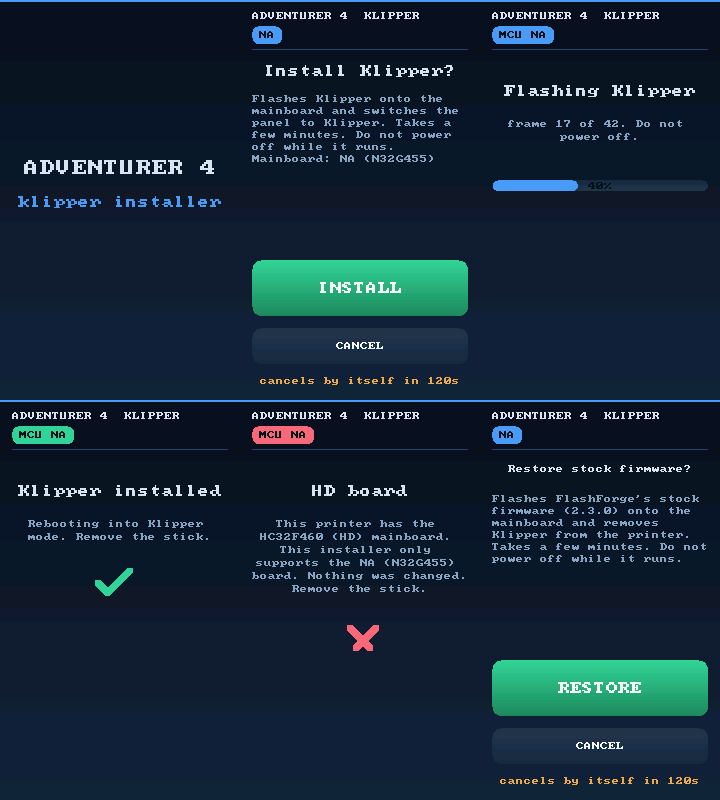

# Flashforge Adventurer 4 on Klipper

Mainline Klipper on the Adventurer 4's own mainboard, installed and removed
with a USB stick. No soldering, no programmer, no extra hardware on the
printer: the printer's Linux SoC carries the MCU's serial port to your
Klipper host over Ethernet, and FlashForge's own flasher, already on every
printer, writes the firmware.



## Supported

| Mainboard | MCU | Status |
|---|---|---|
| **NA** | Nation N32G455 | **Supported.** Install and rollback sticks, printing daily. |
| HD | HDSC HC32F460 | Not supported by the sticks (they refuse). An older, unverified port lives in [experimental/hc32](experimental/hc32/). |

The printer needs FlashForge firmware 2.3 (the MCU kit in
`/opt/PROGRAM/control/2.3.0`). The installer checks this, and the board type,
before it changes anything.

## Quick start

1. Set up a Klipper host (Raspberry Pi or any Linux box with Klipper,
   Moonraker and Mainsail/Fluidd), wired to the printer's Ethernet port.
2. On the host: `host/install-host.sh PRINTER_IP` (adds `socket://` serial
   support to Klipper and installs [host/printer.cfg](host/printer.cfg)).
3. Unzip `ad4-klipper-install-*.zip` (from Releases, or
   `tools/build-release.sh`) onto an empty FAT32 USB stick. Edit
   `ad4-klipper/ad4-klipper.conf` if you want a static address.
4. Printer off, stick in, power on. Tap **INSTALL** on the panel. About two
   minutes later it reboots into Klipper.

Full steps: [docs/INSTALL.md](docs/INSTALL.md).
Back to stock: [docs/ROLLBACK.md](docs/ROLLBACK.md), the same thing with the
`ad4-stock-rollback-*.zip` stick.

## What you get

- Mainline Klipper (`020d25e`, unmodified MCU code) on the N32G455.
- `ad4-bridge` on the printer: the MCU UART (`/dev/ttyS1`, 115200 8N1) as a
  TCP port (5000). Klipper connects with `serial: socket://PRINTER_IP:5000`.
- The stock touchscreen as a Klipper status panel: temperatures, progress,
  PREHEAT / COOLDOWN / PAUSE / RESUME / CANCEL, and an automatic
  `FIRMWARE_RESTART` after the printer is power-cycled.
- SSH (dropbear) on the printer as root.
- A printer.cfg with every pin taken from the stock firmware and checked on
  a running printer: steppers, TMC2209 UART, endstops, heaters, thermistor
  curves, all three fans, PRINT_START / PRINT_END.

## Docs

| | |
|---|---|
| [INSTALL](docs/INSTALL.md) | host, stick, first boot, first print |
| [ROLLBACK](docs/ROLLBACK.md) | back to FlashForge's firmware |
| [HOW-IT-WORKS](docs/HOW-IT-WORKS.md) | boot chain, flashing, why it cannot brick |
| [TROUBLESHOOTING](docs/TROUBLESHOOTING.md) | panel messages, Klipper errors |
| [HARDWARE](docs/HARDWARE.md) | pin map, calibrated values |
| [BUILD](docs/BUILD.md) | rebuild the binaries, the firmware and the release zips |
| [reference/](docs/reference/) | IAP protocol notes, N32 thermistor analysis |
| [improvements/](improvements/ROADMAP.md) | features beyond bring-up: roadmap and status |

## Layout

```
stick/install/     install stick script          stick/common/   shared: lib.sh, boot script, settings
stick/rollback/    rollback stick script         src/            ad4-bridge, ad4-screen, ad4-buzz (C)
bin/               prebuilt ARM binaries         firmware/       Klipper defconfig, hex, build.sh
host/              printer.cfg, Klipper patch    tools/          release builder, dev tools
docs/              documentation                 experimental/   HC32 (HD board) port, unverified
improvements/      roadmap of extra features
```

## Credits and licence

The HC32F460 port, the IAP protocol work and the first SoC bridge are
berthy456's ([adv4-klipper-hc32](https://github.com/berthy456/adv4-klipper-hc32)),
which this repository grew out of. Klipper is by Kevin O'Connor and
contributors. `bin/dropbear` is Dropbear SSH 2022.83 (MIT licence).

FlashForge's firmware and tools are not in this repository and are never
copied onto the sticks: both sticks use the copy every printer already has.

GPLv3, see [LICENSE](LICENSE). Use at your own risk: this replaces the
firmware on your printer's mainboard.
